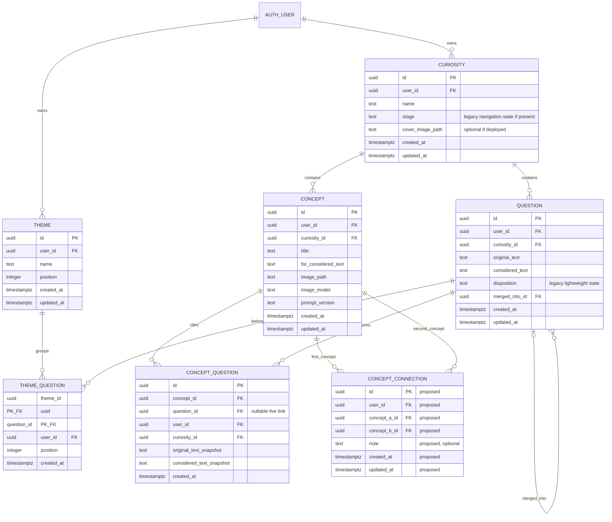
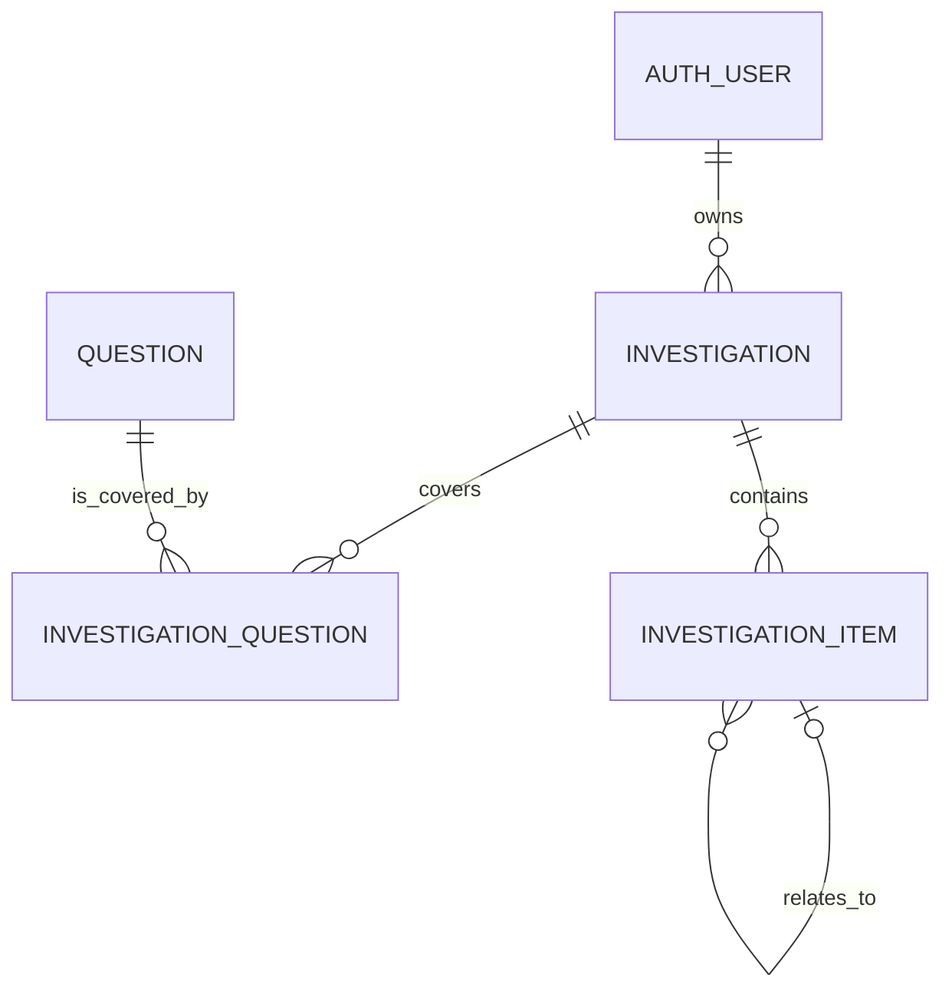

# Curitopia Entity-Relationship Model

**Status:** Updated conceptual model for the new Curitopia experience. Existing V2 records and constraints are distinguished from proposed additions.  
**Purpose:** Describe questions, visual concepts, provenance, and the proposed way to record a user-recognised connection between concepts.  
**Important:** This document is not approval to add tables, run SQL, alter RLS, or apply migrations. Confirm the current source tree and hosted Supabase migration history first.

## 1. Model goals

- A person owns multiple curiosities. A curiosity is a persistent context for questions and concepts; it is not an exploration session, stage, task, or completed item.
- A question preserves its original wording and may also have a considered wording.
- A person can visualise any question directly. No curation state, theme, or investigation is required first.
- A visual concept is an independent Library record: one selected original image, a title of one or two words, the exact wording the image was made for, and links to all questions that informed it.
- The relationship from questions to concepts is many-to-many. One question may inform many concepts; one concept may be informed by many questions.
- The concept card's title and question are rendered as application overlays. They are not baked into or stored as modifications to the original image.
- A person can compare concepts from different curiosities and may explicitly record a connection. This requires a concept-to-concept relationship distinct from `concept_questions`.
- User identity and ownership boundaries are enforced for every persisted record and link.
- No concept has a completed state. There is no required pipeline.

## 2. Entity overview

The diagram combines the existing model and a proposed connection entity. `CONCEPT_CONNECTION` is not a deployed table. `cover_image_path` is shown as optional only if the later curiosity-cover migration is present in the current deployment; verify its exact name and status in the live schema before using it in code.

## 3. Existing V2 account model

The original architecture records `supabase/migrations/20261026000000_initial_v2_schema.sql` as the deployed first-release account model. It describes questions, concepts, concept-question provenance, and optional themes. The curiosity model was described in a later migration, `supabase/migrations/20261028173000_curiosities.sql`; the uploaded source file records that migration as not applied at the time it was written.

Curitopia 2 has since evolved, including curiosity cover-image work. Therefore, treat the above migration status as a historical note, not a live assertion. Inspect the repository's migration files and hosted Supabase migration history before relying on any table/column status or running SQL.

### 3.1 Curiosity

A curiosity is a named workspace that contains the person's questions and concepts. It has no completed state. Switching curiosities must not mix their Garden questions, but the account-wide Library can aggregate concepts across them for comparison.

A `stage` column is present in the older model description as the last-opened stage. In the new experience there are no required stages. If this column exists, treat it as legacy navigation state: do not use it to gate the user or drive the main navigation. Do not drop it until current code and migration use have been audited.

A cover image, where supported by the current deployment, is optional presentation metadata for the curiosity. It is separate from concept artwork and does not change question/concept ownership.

An Experience belongs to exactly one curiosity. The foundation stores one `experiences` row, created when the person opens that screen and resumed on later visits. `curiosity_id` cannot change after insert. The row does not change the curiosity's stage. The migration file is version-controlled and is not applied to the production database. North Star, circles, and conversation history are not part of this row.

### 3.2 Question

A question belongs to one person and one curiosity. It has:

- `original_text`: required capture text; preserve the wording as entered.
- `considered_text`: optional refined wording used when the person chooses to refine the question.
- `disposition`: the older values are `gathered`, `retained`, `parked`, and `discarded`.
- `merged_into_id`: the legacy merge pointer, if present.

The new UX does not require a question disposition change before visualisation. Disposition is not a stage or score. Preserve stored values during the UX refactor; reassess the interface semantics separately.

A merge pointer is not an independent branch relationship. Curitopia has used a Branch interaction to link two separate questions. Verify how that feature is persisted in the current app and hosted migrations. Do not overload `merged_into_id` to implement Branch.

### 3.3 Theme and theme membership

Themes remain optional labels for grouping questions. A question may belong to zero or more themes. A theme may contain zero or more questions. Themes do not own images or concepts, and no theme is required before a question can be visualised.

The original model describes `theme_questions` with `(theme_id, question_id)` as its primary key, a repeated `user_id`, position, and creation timestamp. Deleting a theme removes its memberships; it does not delete questions or concepts.

### 3.4 Visual concept

A concept is an independent Library record. It does not require a surviving source question, does not have an anchor-question column, and has no completed flag.

The original model describes these fields:

- `id`, `user_id`, and `curiosity_id`;
- `title`;
- `for_considered_text` — the exact question wording the selected image represents;
- `image_path` — the original selected artwork in private storage;
- `image_model` and `prompt_version`;
- creation and update timestamps.

Saving another selected image creates another concept; it does not silently replace an existing concept. Retitling updates the existing concept.

#### Title rule

The existing title rule is one word, or two words joined by exactly one ordinary space, with a maximum length of 40 characters. One word is valid; two is the maximum. The application and database should enforce the same check. Suggestions are temporary; there is no title-suggestions entity.

#### Image composition rule

The stored `image_path` is the original image returned by image generation and selected by the person. The application composes the standard concept presentation from three independent parts:

- title overlay at the top, from `concepts.title`;
- original artwork in the centre, from `concepts.image_path`;
- question overlay at the bottom, from `concepts.for_considered_text`.

Do not write the title/question into the stored image. Render them in the UI. An export may create a separate flattened derivative, but it must not overwrite the original object or change `image_path`.

The bottom question is the exact wording sent to image generation, normally the considered wording. It is immutable context for that saved artwork unless the person explicitly creates a replacement concept. Later edits to the live question must not silently change it. When more than one source question informed the concept, `for_considered_text` remains the primary generation question; `concept_questions` records the additional provenance.

### 3.5 Concept-question provenance

`concept_questions` is a many-to-many link from concepts to their source questions. The original model describes it as including:

- a live `question_id`, nullable when the source question is removed;
- `original_text_snapshot` and `considered_text_snapshot`;
- `user_id` and `curiosity_id` ownership/context;
- a creation timestamp.

Snapshots preserve the historical wording. Deleting a live question clears only the live reference where the configured FK supports it; the concept, image, title, generation wording, and snapshots remain. Editing or parking a question does not rewrite the saved concept.

This relationship is provenance. It must not be repurposed to connect two concepts.

## 4. Proposed addition — concept-to-concept connection

### 4.1 Why it is separate

The new product insight is that placing two concepts beside each other can reveal an idea-level relationship that neither concept exposed alone. This is not the same as two questions informing one concept. A concept-to-concept connection needs its own representation if the user chooses to preserve it.

### 4.2 Proposed `concept_connections` shape

A minimal additive proposal for review:

| Field | Type / intent | Required? |
|---|---|---:|
| `id` | UUID primary key | Yes |
| `user_id` | Owner; both concepts must belong to this user | Yes |
| `concept_a_id` | First concept in the selected pair | Yes |
| `concept_b_id` | Second concept in the selected pair | Yes |
| `note` | Optional user-authored observation about the relationship | No |
| `created_at` | Creation timestamp | Yes |
| `updated_at` | Last edit timestamp | Yes |

Model rules to resolve in a migration design:

- A connection is undirected: A–B is the same pair as B–A.
- A concept cannot connect to itself.
- Store a pair once per owner, using canonical UUID ordering or an equivalent uniqueness strategy.
- Both concepts must have the same `user_id` as the connection.
- Concepts may belong to different curiosities. Do not impose a same-curiosity constraint; the Library comparison is account-wide.
- `note` is optional, user-authored, and editable. An AI suggestion is not stored unless the person explicitly adopts or edits it.
- Deleting a connection never deletes either concept.
- Deleting a concept must delete or safely detach the connection record; choose and test explicit FK behaviour before migration.
- RLS must scope every operation to `auth.uid()` and reject cross-owner references.
- The user may compare a pair without creating a connection record. A saved relationship is an explicit action.

The first connection implementation should not add a mandatory relationship type such as “similarity”, “analogy”, or “tension”. The person's own note may describe the connection, or the relationship may be saved without a note. Classification can be reconsidered after real use.

A new question created from a connection is an ordinary question in a curiosity selected by the user. Whether the relationship should store a direct reference to that resulting question is open; do not add a `resulting_question_id` before its lifecycle and navigation behaviour are specified.

**Standing:** proposed only. No migration, table, policy, or relationship type is approved by this document.

## 5. Transient and non-entity concepts

The following should not become persistent database entities merely to support the initial experience:

- candidate images in an in-progress generation set;
- rejected images;
- unused title suggestions;
- an in-progress side-by-side comparison selection;
- temporary reflection prompts or AI readings;
- a presentation overlay or preview composition;
- a thumbnail derived from a stored concept image.

A separate export asset may be generated in a later feature, but the original image remains the source of truth.

## 6. Later release — the Lab

The Lab remains a possible later, optional investigation capability. It is not a primary surface in the new core loop and does not gate Visualise or comparison.

The original sketch describes:

An investigation has a short title and no completed state. It may link to multiple questions. Item kinds remain `concept`, `note`, `hypothesis`, `test`, `observation`, and `discovery`. The `concept` item kind is a written thought within the Lab, not a visual Library concept. Lab items do not own images. This sketch is not in the current first-release migration and is not approval to implement it.

## 7. Earlier drafts

The original architecture identifies these proposals as historical and not deployable:

- `v2-initial-schema-draft.sql` and related-item validation SQL, which proposed explorations, Quickfire/Focus, focus images, and investigation thumbnails;
- `v2-revised-schema-proposal.md`, which put one image on `questions` and used a `question-images` bucket;
- `v2-phase1-migration-proposal.md`, which proposed additive tables on the V1 database;
- `hosted-catalog.sql`, a historical inventory rather than a V2 setup step.

Do not apply these drafts. V1 is untouched and outside the V2 model.

## 8. Integrity and security requirements

Preserve the established V2 security model and verify the exact live configuration before making changes:

- Every question, theme, and concept has one owner; `user_id` cannot be changed by the client.
- Composite foreign keys or equivalent server-side checks reject links across owners.
- `concept_questions` snapshots remain immutable after creation; a live question link may be detached without losing its snapshot.
- RLS is enabled and scoped to `auth.uid()` for each owner-owned table.
- The browser uses the signed-in user's JWT. It does not use a service-role client.
- Private image storage remains owner-scoped. The original model describes `concept-images` at `{user_id}/{concept_id}/{filename}`, with an 8 MiB limit and PNG/JPEG/WebP only. Verify current bucket configuration before changing it.
- Image deletion uses the Storage API, not direct SQL deletion from `storage.objects`.
- Failed file cleanup is reported and can be retried; do not silently orphan or remove files belonging to another concept.
- A future `concept_connections` table must receive the same owner isolation and cross-owner integrity protections.

The original model states RLS is enabled on its five first-release tables, with `authenticated` access scoped by `auth.uid()` and no browser grant to `service_role`. Treat those details as a baseline to verify, not as a substitute for inspecting the hosted configuration.

## 9. Standing of this model

### Existing model decisions to preserve

- V2 is separate from V1; no V1 import is implied.
- Questions preserve original wording and optional considered wording.
- Concepts are independent records with an original image, title, generation wording, and model/prompt metadata.
- `concept_questions` is a many-to-many provenance relationship with wording snapshots.
- A concept remains if a source question is edited, parked, or removed.
- A title is one or two words under the existing 40-character database rule.
- Optional themes are not a required step.
- No completed-concept state exists.

### New product requirements

- The concept card composes title (top), original artwork (centre), and exact generation question (bottom) at presentation time.
- Concept comparison can cross curiosity boundaries.
- A saved concept-to-concept connection is distinct from question provenance.

### Not yet implemented or not confirmed

- A persistent `concept_connections` table and its RLS/FK rules.
- Whether an existing Branch interaction is stored in a separate question-link structure or in another persistence layer.
- The current hosted status of the curiosity migration and cover-image column.
- Any direct provenance link from a saved connection to a question created from it.
- A flattened image export of the concept card.

No SQL or migration is approved by this document. Confirm the current codebase and database before implementing any of the above.
