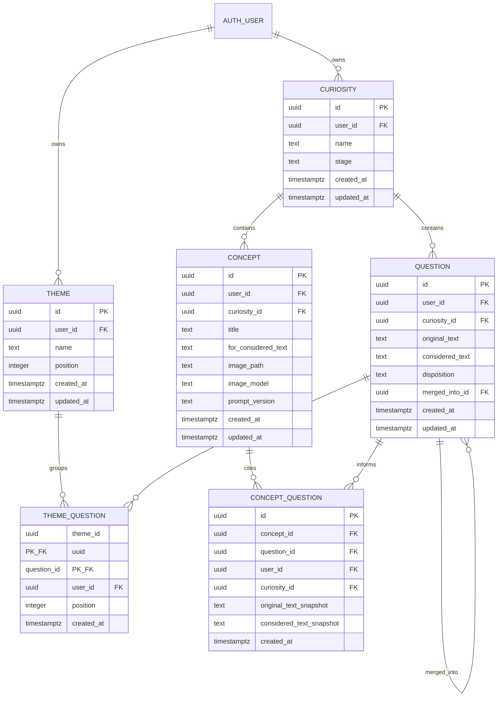
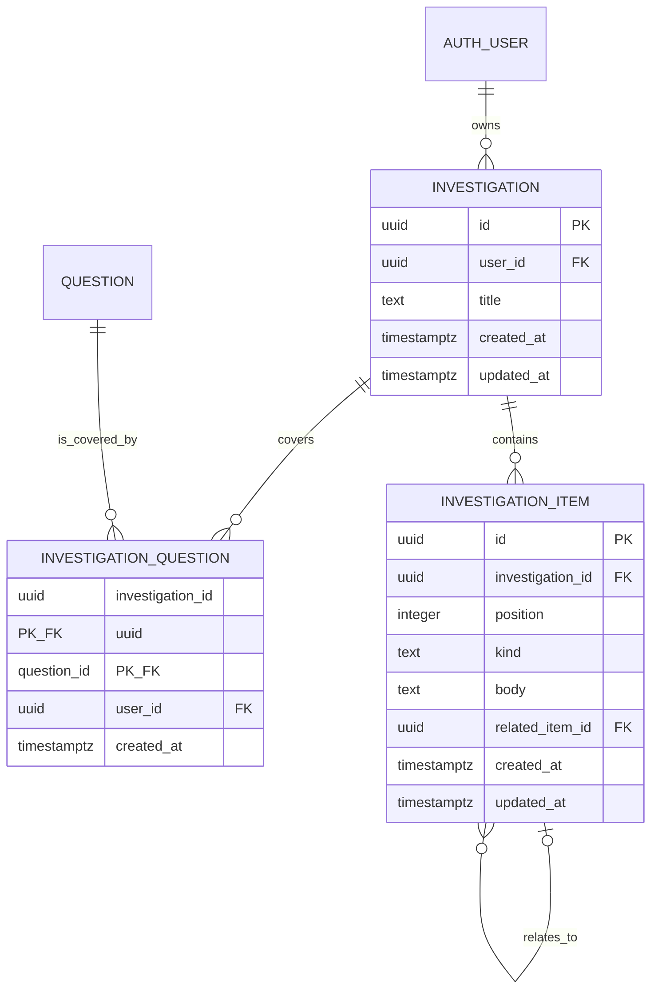

# Curitopia Entity-Relationship Model

**Status:** Deployed first-release model, plus later sketches that are not tables. This file is not permission to add tables or run SQL.  
**Migration:** `supabase/migrations/20261026000000_initial_v2_schema.sql` is deployed. `supabase/migrations/20261028173000_curiosities.sql` adds curiosities and has not been applied.  
**Explanation:** `docs/schema-inventory/proposals/v2-initial-schema-proposal.md`  
**Experience:** `Curitopia_Garden_Experience_Framework.md` and `PRODUCT_VISION.md`.

V1 tables are untouched. V2 does not import them. The first-release tables below are the account model. The Lab sketch and the concept-to-concept note are not in that model.

## 1. Model goals

- The person owns curiosities. Each curiosity owns its questions and concepts. Themes stay optional labels on the account. A curiosity is not an exploration, and it has no completed state.
- A question keeps its original text and its optional considered text.
- The Library of Curiosities is a collection of concepts. A concept is one selected image, a title of one or two words, the wording that image was made for, and any number of source questions. The title is part of the concept, not a caption stored elsewhere. A question may inform any number of concepts. A concept is never a completed status. There is no relationship between two concepts in this model.
- A question can belong to zero or more themes. A theme can contain zero or more questions. Themes are optional in the journey and included in this schema.
- The Lab, meaning investigations, is a later release. It is not a stage of the four-stage cycle and it is not in this migration.
- Stories, vision boards, candidate images, focus backdrops, and item thumbnails are not entities.
- `user_id` on each top-level record is the owner. Join rows repeat `user_id` so a link cannot cross owners.

## 2. First release

A curiosity has a name and the last opened stage. It has no completed state. Questions and concepts point at one curiosity, and that pointer cannot be changed. A merge stays inside the same curiosity. Provenance links carry the same curiosity as the concept. Deleting a live question still clears only `concept_questions.question_id`. The snapshots remain. The curiosity migration has not been applied, so the hosted database does not have this table yet.

The private bucket `concept-images` is not a table. `concepts.image_path` is `{user_id}/{concept_id}/{filename}`. The curiosity migration does not rewrite those paths.

### Question

`original_text` is required and is not rewritten by a merge. `considered_text` is null until the person saves a considered question. `disposition` is `gathered`, `retained`, `parked`, or `discarded`. The application has no disposition value `merged`. A merge is `merged_into_id`. Restore clears that pointer. The application also sets disposition back to `gathered` when it restores; the database does not force that second write.

`merged_into_id` cannot be the same row, cannot point at another person's question, cannot be retargeted without a restore, and cannot form a cycle. Deleting a survivor while other questions still point at it fails at commit and leaves those source wordings in place. Deleting a merged source removes that row. The prototype does not hard-delete questions; park and discard are the reversible actions.

### Theme

A theme is a name and a position. It has no description. Names are unique per owner, ignoring case and surrounding spaces. An empty theme, meaning a theme with no questions, is valid. Deleting a theme deletes memberships only.

### Theme membership

`theme_questions` uses `(theme_id, question_id)` as its primary key. Both foreign keys include `user_id` and cascade. Deleting a question removes its memberships and leaves the theme.

### Concept

A concept does not require a surviving question. It has no anchor column and no completed flag. Saving another image creates another concept, so one question can inform many. The schema does not collapse those into one row.

`title` is one word, or two words joined by exactly one ordinary space, at most 40 characters. One word is valid. The application and this check both enforce the limit. A title suggestion that fails it is not stored by another path. `for_considered_text` is the considered wording the selected image was made for. `image_model` and `prompt_version` are required. Demo fixtures in the browser can have a data URL and a null model. Those fixtures are not rows in this schema. There is no column for a temporary title suggestion. Retitling updates `title` on the existing row.

### Concept link

`concept_questions.question_id` is nullable. The foreign key is `(question_id, user_id)` with `ON DELETE SET NULL (question_id)`, so only the live reference is cleared. `original_text_snapshot`, `considered_text_snapshot`, and `user_id` stay. The owner can still read a detached row. A live link cannot point at another person's question. Snapshots cannot be edited. A link can be detached. It cannot be retargeted.

Editing or parking a live question does not change the snapshots or `concepts.for_considered_text`.

## 3. Later, and not designed — a relationship between two concepts

Connect, described in `USER_JOURNEYS.md`, would let a person choose two existing concepts and explore what joins them. The deployed model cannot store that. `concept_questions` is provenance from questions to a concept. It is not a concept-to-concept link, and it must not be overloaded into one.

No table, foreign key, or list of relationship types is specified here. Whether a connection is a pair, a note, a new question, or something else is an open decision, taken when that experience is scheduled. Until then, two concepts can be viewed together without a stored link.

## 4. Later release — the Lab

Not in this migration. Specified here so the Lab is not confused with the Library.

An investigation has a short title and no completed state. It may have zero linked questions at the database.

There is no `theme_investigations` table.

Each item belongs to one investigation. Kinds are `concept`, `note`, `hypothesis`, `test`, `observation`, and `discovery`. The kind `concept` is a written thought inside the Lab. It is not a visual concept and it is not a row in the Library. There is no `image_path`. Whether that kind is renamed is still open. An optional related item must be in the same investigation, must not cycle, and must not exceed a depth of 32. The foreign key from `related_item_id` should be `ON DELETE NO ACTION DEFERRABLE INITIALLY DEFERRED`. That rule is for a later migration.

Items do not copy question text. A visual concept is not an investigation item.

## 5. Earlier drafts

`v2-initial-schema-draft.sql` and the related-item validation SQL proposed explorations, Quickfire/Focus, focus images, and investigation thumbnails. They are history. Do not apply them.

`v2-revised-schema-proposal.md` put one image on `questions` and used a `question-images` bucket. That image placement is withdrawn. Do not apply it.

`v2-phase1-migration-proposal.md` proposed additive tables on the V1 database. It is withdrawn.

`hosted-catalog.sql` is a historical inventory. It is not a V2 setup step.

## 6. Integrity and security

These rules are the ones in the deployed migration. This section is not approval to change them.

- Every question, theme, and concept has one owner. `user_id` cannot change.
- Theme membership uses composite foreign keys, so both parents share that owner.
- A concept link's composite foreign key rejects a live question owned by someone else. The trigger keeps snapshots unchanged and allows a link to be detached rather than retargeted. Detached provenance remains readable by the concept owner.
- Row level security is enabled on the five tables and is not forced. Forcing it does not decide whether `ON DELETE SET NULL` can run. Policies are `to authenticated` and use `(select auth.uid()) = user_id` for select, insert, update, and delete.
- `authenticated` can select, insert, update, and delete its own rows. `anon` is not granted those privileges. The migration does not grant `service_role`. The browser does not use a service-role client.
- Deleting a theme removes its memberships. Questions, concepts, and files stay.
- Deleting a question removes its theme memberships, nulls live concept links, and leaves each concept with its image path, title, `for_considered_text`, and snapshots.
- Deleting a concept removes its links. The image file is removed through the Storage API, not by SQL. If that removal fails, the failure is reported and can be retried.
- Deleting an auth user can remove their questions, themes, concepts, and memberships in one cascade because the merge foreign key is deferred. The application removes their image files through the Storage API first. If file removal fails, the account deletion does not proceed. That sequence is not in the migration.
- There is one private image bucket, `concept-images`, at `{user_id}/{concept_id}/{filename}`, with an 8 MiB limit and PNG, JPEG, or WebP only. There is no thumbnail bucket, no focus-image bucket, and no story bucket. The schema requires PostgreSQL 15 or later.

## 7. Standing of this model

- [x] V2 is a separate Supabase project. V1 is not modified and is not imported.
- [x] A question may inform many concepts, and a concept may be informed by many questions. The concept remains when a source is edited, parked, or removed.
- [x] The columns, keys, private path, and removal mechanics for this first release are the deployed migration named above.
- [x] Original text and considered text are both stored. Merge is a pointer, not a fifth disposition.
- [x] Optional themes are `themes` and `theme_questions`. One name per owner, ignoring case and surrounding spaces. They are not a required step in the cycle.
- [x] A title is one or two words. Suggestions are not a stored entity.
- [x] Investigations are not in this release. The item kind `concept` is not a Library visual concept.
- [x] A visual concept has no completed state.
- [ ] A relationship between two concepts. Not designed. Section 3 records the requirement and forbids inventing the table early.

Confirmations still required are listed in `PRODUCT_VISION.md` section 10. The 8 MiB ceiling and the private path are the schema defaults.
