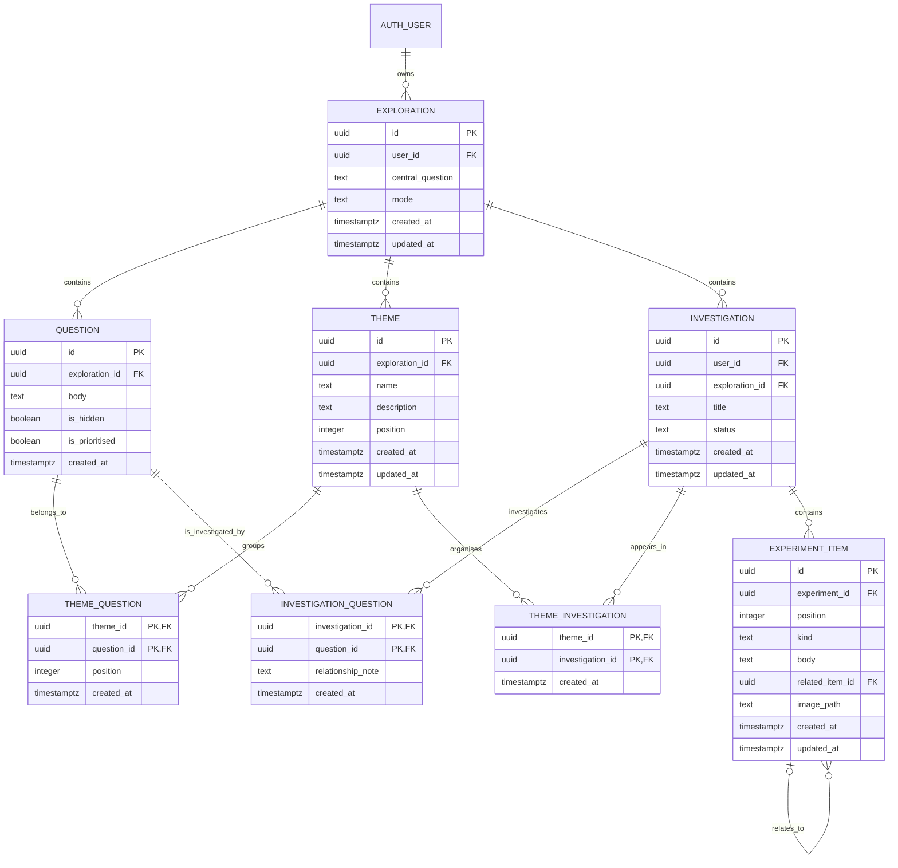

# Curitopia Entity-Relationship Model

**Status:** Proposed target model for review. This document is not a database migration and must not be executed against hosted Supabase.  
**Goal:** Allow related questions to share themes and investigations, reducing workspace sprawl while preserving question identity and existing data.

## 1. Model goals

- One exploration can contain many questions, themes and investigations.
- A question can be in zero, one or several themes.
- One theme can organise many questions.
- An investigation can cover several questions; a question can be explored by several investigations.
- An investigation can optionally be connected to one or more themes.
- Experiment items belong to one investigation, not to a duplicated copy of a question.
- Stories are browser-only compositions of selected content; they are not persisted entities in this release.
- All persistent records and stored assets remain scoped to the authenticated owner through existing Supabase RLS and ownership checks.

## 2. Proposed logical ER diagram

> `INVESTIGATION` is the conceptual target for the current `experiments` table. `EXPERIMENT_ITEM` is the conceptual target for the current `experiment_items` table. Names in this diagram explain the desired model; they do not require renaming the existing tables.

## 3. Relationship semantics

### User → Exploration

One authenticated user owns zero or more explorations. Every exploration and all data reached through it must be owner-scoped. Existing authentication, Row Level Security and service-side ownership checks remain authoritative.

### Exploration → Question

Each question belongs to exactly one exploration. A question's hidden/prioritised state remains properties of that question. Hiding or unprioritising it must not delete theme links or investigation links.

### Exploration → Theme

A theme belongs to one exploration. A theme is a grouping/label, not a container that owns or copies question text. Renaming or deleting a theme must not delete its questions.

### Theme ↔ Question (many-to-many)

`theme_questions` joins the two records. A question may have no theme or be associated with multiple themes. A theme may contain multiple questions. The composite key `(theme_id, question_id)` prevents duplicate links. The database must enforce that both records belong to the same exploration and owner, either with suitable constraints or trusted server-side checks plus RLS.

### Investigation ↔ Question (many-to-many)

`investigation_questions` is the critical change that addresses experiment sprawl. One investigation can support several questions; a question can connect to several investigations. A link may optionally explain how the investigation relates to the question, but the relationship note should not duplicate canonical question content.

Do not make question selection a hard requirement for every investigation unless that is an explicit product decision. The UI may start an investigation from a question and also allow the user to link additional questions later.

### Theme ↔ Investigation (many-to-many, optional)

`theme_investigations` allows an investigation to appear within a theme without restricting it to a single theme. This relationship is optional; it must not be used to force a user through a theme before starting an investigation.

If implementation evidence suggests this relationship is unnecessary for the first release, defer this join table rather than introducing it pre-emptively.

### Investigation → Experiment Item

Each item belongs to one investigation and retains its kind, body, order, optional image path and existing relationship/parent semantics. Existing supported kinds remain `concept`, `note`, `hypothesis`, `test`, `observation` and `discovery`.

An item's optional related-item relationship must stay within the same investigation and preserve current cycle/depth constraints. Moving or removing an item must not silently change its content type or invent an outcome.

### Story composition (transient, not in the ER diagram)

A Story draft is a browser-side ordered list of selected question and experiment-item references, plus per-slide presentation state (subtitle, accepted temporary artwork, opening/closing configuration and export options). It exists only during the tab's editing session. It is not written to a Story table or storage bucket, and exporting a video creates a local download. This remains the current privacy boundary; saved drafts would require a separate decision.

## 4. Mapping from the current schema

The current implementation has `public.explorations`, `public.questions`, `public.experiments` and `public.experiment_items`. The current `experiments` table is tied to one `question_id`, and the question link is unique, so the schema currently constrains the one-question/one-experiment relationship.

The target model should **not** be implemented by changing only the interface. It requires additive relationship records and a carefully staged compatibility migration.

### Recommended migration strategy — additive first

1. **Inventory and baseline:** inspect the real hosted schema, constraints, foreign keys, RLS policies, grants, triggers, actions and queries. Back up or otherwise follow the established database change procedure. Never assume the docs perfectly reflect hosted state.
2. **Add themes and relationship tables:** create `themes`, `theme_questions` and `investigation_questions` with appropriate owner/exploration integrity, indexes, uniqueness and RLS. Add `theme_investigations` only if retained in the approved first slice.
3. **Backfill existing links:** for every existing experiment, insert a link between its current `question_id` and `experiment_id` into `investigation_questions`. Do not rewrite or discard experiment items. Make the backfill idempotent.
4. **Ship compatibility-aware application code:** read established links through the join table while supporting legacy records during rollout. New writes must avoid creating duplicate or contradictory relationships. Test old experiment routes and reopen flows.
5. **Relax the legacy constraint only when safe:** after all application code no longer relies on the one-to-one `experiments.question_id` constraint, use a separately reviewed migration to remove the unique restriction and/or retire the old column as appropriate. Do not drop it in the initial additive migration.
6. **Verify access and rollback:** test owner isolation for themes, links, investigations and items; test that cross-exploration links are rejected; test deletion behaviour; and record a rollback plan before applying changes to hosted Supabase.

Do not run any SQL as part of drafting this model. Each migration must be separately inspected, approved and applied according to the project's established hosted-Supabase workflow.

## 5. Integrity and security requirements

- Every theme belongs to one exploration and one owner.
- Every question in a theme belongs to the same exploration as that theme.
- Every question linked to an investigation belongs to the same exploration as that investigation.
- Every theme linked to an investigation belongs to the same exploration.
- An investigation item is accessible only through its owner-scoped investigation.
- The related-item parent, where present, must be in the same investigation; current cycle/depth checks continue to apply.
- Enforce row-level security for every new persistent table; verify read/write policies and grants separately.
- Reject cross-owner and cross-exploration relations in trusted server-side operations, not just in client-side validation.
- Deleting a theme removes only its join links and the theme record, not questions, investigations or experiment items.
- Deleting a question should not automatically delete a shared investigation. The application must define whether to remove its links, retain the investigation as unlinked, or request confirmation.
- Deleting an investigation may delete its own items according to existing rules, but must not delete linked questions or themes.

## 6. Questions-per-minute gauge data

The gauge is a UI measurement, not a new persistent entity in the initial design.

- Count only successfully saved new questions in a rolling 60-second window.
- Do not count edits, failed saves or generated suggestions until the user explicitly adds them.
- Default to current-tab state; clear the event window when it expires or the active session ends.
- Do not store per-user rates, make public leaderboards or turn the rate into a quality score without a separate decision.

## 7. Review decisions before any migration

- [ ] Confirm the theme and investigation relationships.
- [ ] Decide whether multiple themes per investigation are needed in the first release.
- [ ] Agree deletion and unlinking semantics.
- [ ] Define how the UI identifies an investigation's related questions.
- [ ] Define and test the questions-per-minute experience.
- [ ] Review the target model against the actual schema and RLS policies.
- [ ] Prepare separate additive SQL and a rollback plan only after these decisions are approved.
